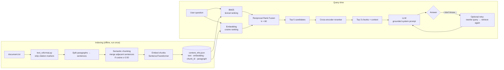
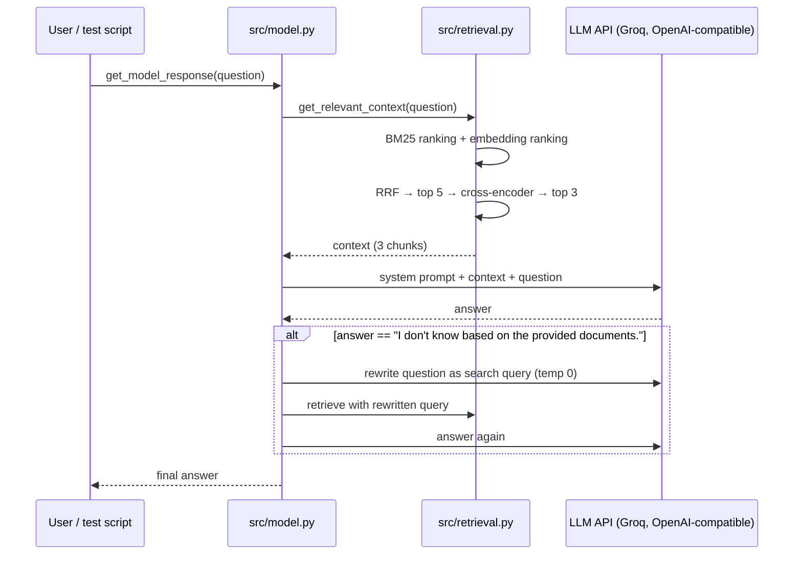

# RAG System — Hybrid Retrieval with Grounded Answering

A small, fully inspectable Retrieval-Augmented Generation (RAG) pipeline built from first principles: no vector database or framework, so every stage (chunking, embedding, lexical search, rank fusion, reranking, generation) is visible and testable.

The system answers questions **only from a source document**, refuses when the answer isn't there, and corrects questions built on false premises.

**Baseline v1 result:** 18 / 20 evaluation questions pass, 2 partial, **0 hallucinated facts, 0 failed refusals**.

---

## Architecture



### Why each stage exists

| Stage | Purpose | Failure it fixes |
|---|---|---|
| Semantic chunking | Keeps related sentences together | Ideas cut across fixed-size boundaries |
| Embedding search | Matches meaning, not words | Reworded questions ("How does RAG save money?") |
| BM25 | Matches exact terms | Names, numbers, acronyms ("2020", "Ars Technica", "paper") that embeddings underweight |
| RRF fusion | Combines both rankings without comparing raw scores | One retriever missing a chunk the other finds |
| Cross-encoder reranker | Reads question + chunk together to judge relevance | Topically similar but non-answering chunks ranked first |
| Grounded prompt | Constrains the LLM to the context | Padding answers with outside knowledge, answering the wrong question |

---

## Request workflow



---

## Project structure

```
RAG-System/
├── document.txt              # Source knowledge (one paragraph per line)
├── text_reformat.py          # Strips [n] citation markers from document.txt
├── content_info.json         # Index: chunk text, embedding, chunk_id, paragraph
├── src/
│   ├── generator.py          # Builds the index (chunk + embed → content_info.json)
│   ├── retrieval.py          # BM25, embeddings, RRF, reranker → context
│   └── model.py              # Grounded prompt, LLM call, retry logic
├── test_cases/
│   ├── direct_questions.py
│   ├── reworded_questions.py
│   ├── understanding_questions.py
│   ├── unanswerable_questions.py
│   ├── false_premise_questions.py
│   └── test_answers/         # Saved model answers per category
└── answers.json              # Earlier combined results
```

---

## Setup

**Requirements:** Python 3.11+

```bash
git clone https://github.com/sreekar-meruva/RAG-System.git
cd RAG-System
python -m venv .venv
source .venv/bin/activate            # Windows: .venv\Scripts\activate
pip install sentence-transformers rank-bm25 scikit-learn numpy openai python-dotenv
```

Create a `.env` file in the repo root (it is git-ignored):

```env
EMBEDDING_MODEL=sentence-transformers/all-MiniLM-L6-v2
ENCODER_MODEL=cross-encoder/ms-marco-MiniLM-L-6-v2
MODEL_URL=https://api.groq.com/openai/v1
MODEL_KEY=your_groq_api_key
MODEL=openai/gpt-oss-20b
```

The embedding and reranker models run locally on CPU and download on first use. Only the LLM call goes over the network. A free Groq API key is enough; Ollama (`http://localhost:11434/v1`) also works as a fully local alternative.

---

## Usage

All commands run from the **repo root**.

```bash
# 1. Clean the source document (once, after editing document.txt)
python text_reformat.py

# 2. Build the index
python -m src.generator

# 3. Run an evaluation category
python -m test_cases.direct_questions
python -m test_cases.reworded_questions
python -m test_cases.understanding_questions
python -m test_cases.unanswerable_questions
python -m test_cases.false_premise_questions
```

Answers are written to `test_cases/test_answers/<category>_answers.json`.

Ask a single question:

```python
from src.model import get_model_response
print(get_model_response("What does RAG stand for?"))
```

---

## Evaluation

20 hand-written questions in five categories, each targeting a different failure mode:

| Category | Count | What it tests |
|---|---|---|
| Direct | 4 | Plain lookups |
| Reworded | 4 | Retrieval when wording differs from the text |
| Understanding | 4 | Combining information, sometimes across chunks |
| Unanswerable | 5 | Refusing instead of using training knowledge |
| False premise | 3 | Correcting a wrong assumption instead of going along with it |

### Baseline v1 results

| Category | Result |
|---|---|
| Direct | 4 / 4 |
| Reworded | 4 / 4 |
| Understanding | 2 / 4 full, 2 partial |
| Unanswerable | 5 / 5 refused |
| False premise | 3 / 3 corrected |

**Known partials**

- *"What are the benefits of RAG besides reducing hallucinations?"* — misses the domain-specific/updated-information benefit. The word "hallucinations" pulls the hallucination chunk into the top 3 and pushes the right chunk out. Retrievers do not understand negation ("besides", "except").
- *"Give two examples of harm caused by AI hallucinations."* — correct examples, but occasionally adds a small detail not in the context.

### How the system got here

| Iteration | Change | Effect |
|---|---|---|
| Prompt v1 | "Answer only from context" | Refused correctly, but padded answers with outside knowledge |
| Prompt v2 | No extra details, 1–3 sentences | Grounded, but answered *when* to a *who* question |
| Prompt v3 | Only answer the exact question asked | Fixed who/when; strictness caused over-refusals |
| Prompt v4 | Separate *understanding the question* (general knowledge allowed) from *facts in the answer* (context only) | Fixed over-refusal on "Which publication…" |
| Prompt v5 | False-premise correction rule | Corrects 2018 → 2020, Wired → Ars Technica |
| Retrieval | Added BM25 + RRF | Exact-term questions retrieve reliably |
| Bug fix | RRF used chunk index as rank position | Chunks 5–6 were unreachable; fixing it fixed two questions |
| Retry v1 | Loose rewrite, temperature 0.7 | **Regression:** turned 2 correct refusals into ungrounded answers |
| Retry v2 | Strict rewrite, temperature 0 | No regressions, no gains |

Lesson from the retry: retrying on *refusal* is risky, because for unanswerable questions the refusal is the correct output.

---

## Design decisions

- **No vector database.** With one document, a JSON index keeps every number inspectable. Chroma or pgvector become worthwhile at scale (see Future updates).
- **Fixed 3 chunks to the LLM.** Keeps the prompt small and limits noise; candidate breadth is handled by retrieving 5 before reranking.
- **Small reranker candidate set (5).** Reranking cost scales with candidates, not collection size.
- **Exact refusal string.** `I don't know based on the provided documents.` makes refusals machine-detectable for evaluation and retry logic.
- **temperature = 0.** Reproducibility for evaluation. Hosted APIs can still vary slightly between runs, so results should be checked over multiple runs.

---

## Future updates

**Retrieval**
- [ ] Paragraph-level or overlap chunking (current semantic chunking can leave one-sentence chunks that lose their subject, e.g. "The technique was first proposed in 2020…")
- [ ] Contextual chunk headers (prepend document title before embedding)
- [ ] Add the reranker's ranking into RRF so it can't single-handedly drop a good chunk
- [ ] Try `BAAI/bge-small-en-v1.5` with its query prefix
- [ ] Stemming for BM25 (`combine` vs `combining`)
- [ ] Load `content_info.json` and BM25 index once instead of per query

**Generation**
- [ ] Retry answers the **original** question with the new context (currently answers the rewritten one)
- [ ] Trigger retry on low retrieval confidence, not on refusal; keep it behind a flag
- [ ] Return cited chunk IDs with each answer

**Evaluation**
- [ ] Single runner for all 20 questions with expected answers and auto-scoring
- [ ] Log retrieved chunk IDs per question; report recall@5 (RRF stage) and recall@3 (after reranker)
- [ ] RAGAS faithfulness and answer relevancy on a larger set (30–50+ questions)
- [ ] Multi-run stability report (pass rate per question over 3 runs)

**Scale and engineering**
- [ ] Multiple documents with metadata filtering
- [ ] Move the index to ChromaDB or pgvector
- [ ] `requirements.txt`, `.env.example`, and pytest-based tests
- [ ] Simple API (FastAPI) or UI (Streamlit) for asking questions

---

## Tech stack

Python · sentence-transformers · rank-bm25 · scikit-learn · NumPy · OpenAI SDK (OpenAI-compatible endpoint) · Groq · python-dotenv
