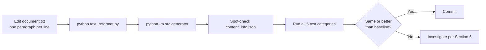
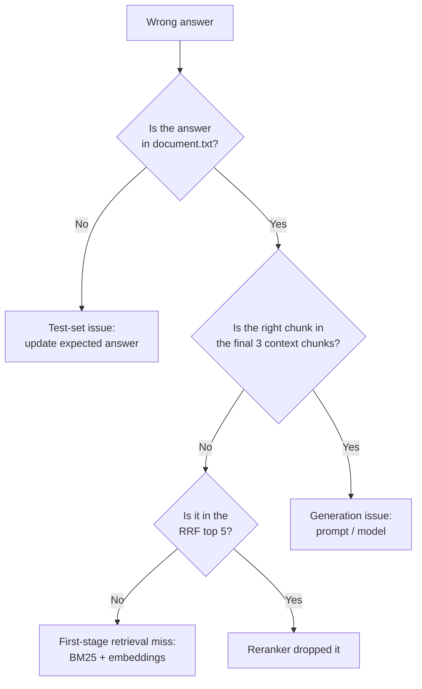

# Runbook — RAG System

Operational guide for setting up, running, updating, evaluating, and troubleshooting the pipeline. All commands run from the **repo root**.

---

## 1. Quick reference

| Task | Command |
|---|---|
| Clean source document | `python text_reformat.py` |
| Rebuild index | `python -m src.generator` |
| Run one test category | `python -m test_cases.<category>_questions` |
| Ask one question | `python -c "from src.model import get_model_response as g; print(g('What does RAG stand for?'))"` |
| Check models reachable | `curl -s $MODEL_URL/models -H "Authorization: Bearer $MODEL_KEY"` |

Categories: `direct`, `reworded`, `understanding`, `unanswerable`, `false_premise`.

---

## 2. First-time setup

1. Create and activate a virtual environment (Python 3.11+).
2. Install dependencies:
   ```bash
   pip install sentence-transformers rank-bm25 scikit-learn numpy openai python-dotenv
   ```
3. Create `.env` in the repo root:
   ```env
   EMBEDDING_MODEL=sentence-transformers/all-MiniLM-L6-v2
   ENCODER_MODEL=cross-encoder/ms-marco-MiniLM-L-6-v2
   MODEL_URL=https://api.groq.com/openai/v1
   MODEL_KEY=your_groq_api_key
   MODEL=openai/gpt-oss-20b
   ```
4. Confirm `.env` is git-ignored: `git check-ignore .env` should print `.env`.
5. Build the index: `python -m src.generator`.
6. Smoke test: ask "What does RAG stand for?" — expect *Retrieval-Augmented Generation*.

**Expected on first run:** the embedding and reranker models download (~80–100 MB each). Later runs load from the local cache.

---

## 3. Updating the knowledge source

Run every time `document.txt` changes.



**Spot-check `content_info.json`:**
- Every chunk has a non-empty `text`.
- No chunk starts with a stray `"` or ends mid-quote.
- Very short one-sentence chunks are noted (they retrieve poorly).
- Chunk count looks reasonable for the document size.

**Rules**
- `text_reformat.py` overwrites `document.txt` in place. Commit or back up the original first.
- Always rebuild the index after changing `EMBEDDING_MODEL`. Vectors from different models are not comparable.
- Chunk IDs are random UUIDs and change on every rebuild. Do not hard-code them in tests.

---

## 4. Running the evaluation

```bash
python -m test_cases.direct_questions
python -m test_cases.reworded_questions
python -m test_cases.understanding_questions
python -m test_cases.unanswerable_questions
python -m test_cases.false_premise_questions
```

Results land in `test_cases/test_answers/`.

**Scoring checklist per answer**

| Check | Pass condition |
|---|---|
| Correct | Matches the expected answer |
| Grounded | Every fact is in the retrieved context |
| Refusal | Unanswerable questions return exactly `I don't know based on the provided documents.` |
| Correction | False-premise questions state the right fact instead of refusing or going along |

**Baseline v1 to compare against:** 18 pass, 2 partial (benefits-besides-hallucinations, harms-of-hallucinations padding), 0 hallucinated facts, 0 failed refusals.

**Run each change at least twice.** Even at `temperature=0`, hosted API outputs vary slightly between runs. Treat one clean run as a signal, not proof.

---

## 5. Making a change safely

1. Create a branch: `git checkout -b <change-name>`.
2. Change **one thing** at a time (prompt, chunking, k, model, retry).
3. Rebuild the index if chunking or the embedding model changed.
4. Run all 5 categories, twice.
5. Compare against the baseline answers question by question.
6. Merge only if nothing regressed. Record the change and its effect in the README iteration table.

**Prompt changes:** every rule added so far fixed one failure and risked another. Always rerun the unanswerable set after a prompt change, because those break first.

---

## 6. Troubleshooting

### Diagnose the stage first

For any wrong answer, print the context sent to the model, then decide:



Debug print to add temporarily in `get_relevant_context`:

```python
print("BM25:     ", list(bm25_ranking))
print("Embedding:", list(embed_ranking))
print("RRF top 5:", list(rrf_ranking[:5]))
print("Final ctx:", top_texts)
```

### Known issues and fixes

| Symptom | Likely cause | Fix |
|---|---|---|
| `402 Payment Required` | LLM provider free credits used up (e.g. Hugging Face) | Switch `MODEL_URL`/`MODEL` to Groq free tier or local Ollama |
| `401 Unauthorized` | Wrong or expired `MODEL_KEY` | Regenerate key; check `.env` is loaded from repo root |
| `404` / model not found | Model ID retired or not on free plan | List models: `GET $MODEL_URL/models`; update `MODEL` |
| `429 Too Many Requests` | Free-tier rate limit | Wait and rerun; run categories one at a time |
| `FileNotFoundError: document.txt` / `content_info.json` | Script run from wrong directory | Run from repo root with `python -m ...` |
| `ModuleNotFoundError: src` | Running a file directly instead of as a module | Use `python -m test_cases.direct_questions` |
| Same chunks returned for every question | RRF ranking bug (rank position vs chunk index) | Confirm `get_rrf_ranking` uses `enumerate(ranking)` position |
| A chunk never appears in context | Ranked below RRF top 5 | Check debug prints; consider chunking fixes |
| Answer includes facts not in context | Prompt drift / model padding | Check system prompt rule 1; rerun twice |
| Correct refusal turns into an answer | Retry rewrote the question into an easier one | Keep retry at temperature 0 with strict prompt, or disable it |
| Answer to a related but different question | "Closest sentence" behaviour | Prompt rule 4 (exact question) |
| `finish_reason == "length"`, truncated answer | `max_tokens=200` too low (reasoning tokens count) | Raise `max_tokens` to 400–800 |
| Slow queries | Models loaded per call | Models must load once at module level (current code does this) |

### Known limitation
Questions with negation ("besides X", "other than X") retrieve chunks about X. Both embeddings and the reranker match on mentioned terms, not exclusions. Query rewriting fixes this at the cost of an extra LLM call.

---

## 7. Baselines and releases

Freeze a working state before experiments:

```bash
pip freeze > requirements.txt
git add .
git status                       # confirm .env is not listed
git commit -m "Baseline vN: <summary and score>"
git tag -a baseline-vN -m "<what this baseline is>"
git push origin main --tags
```

Compare later work against it:

```bash
git diff baseline-v1 -- src/
git checkout baseline-v1         # inspect old version (return with: git checkout main)
```

**Housekeeping before tagging**
- Add `__pycache__/` and `*.pyc` to `.gitignore`, then `git rm -r --cached __pycache__ src/__pycache__ test_cases/__pycache__`.
- Remove scratch files not part of the pipeline (e.g. `check.py`).

---

## 8. Security

- Never commit `.env`. If it was ever committed, remove it with `git rm --cached .env` **and rotate the API key** — it remains in git history.
- Free LLM tiers may use request data for training. Do not index confidential documents while using them; use local Ollama instead.
- `text_reformat.py` and `src/generator.py` overwrite files in place. Keep originals in git.
